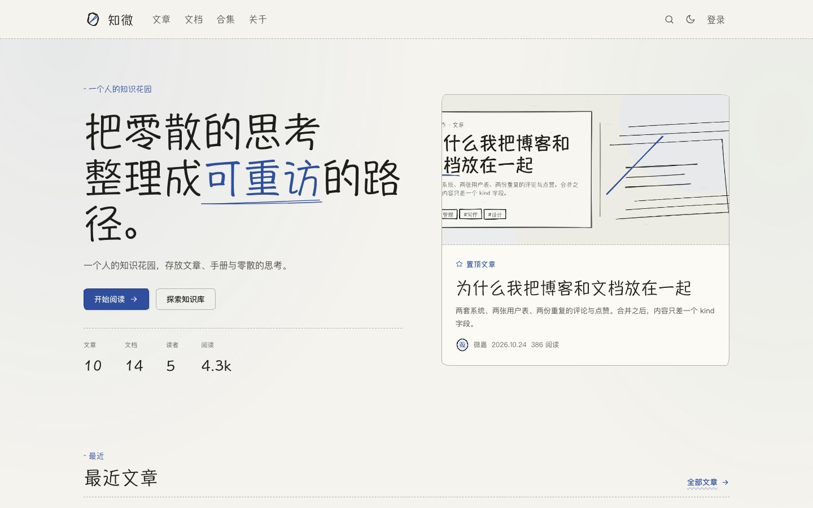
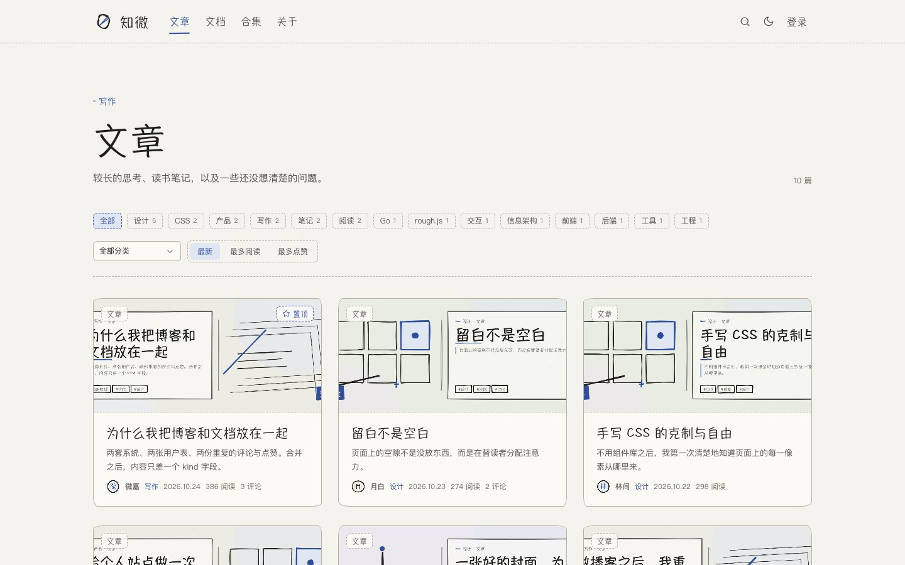
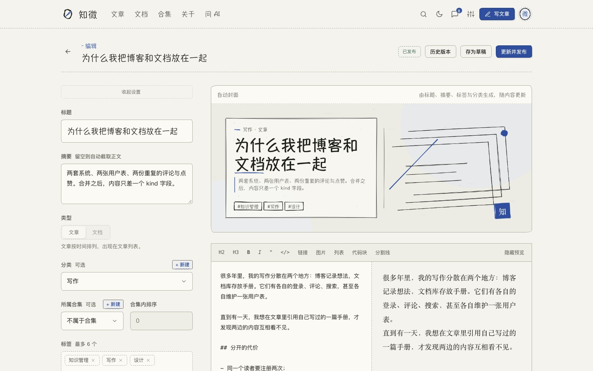
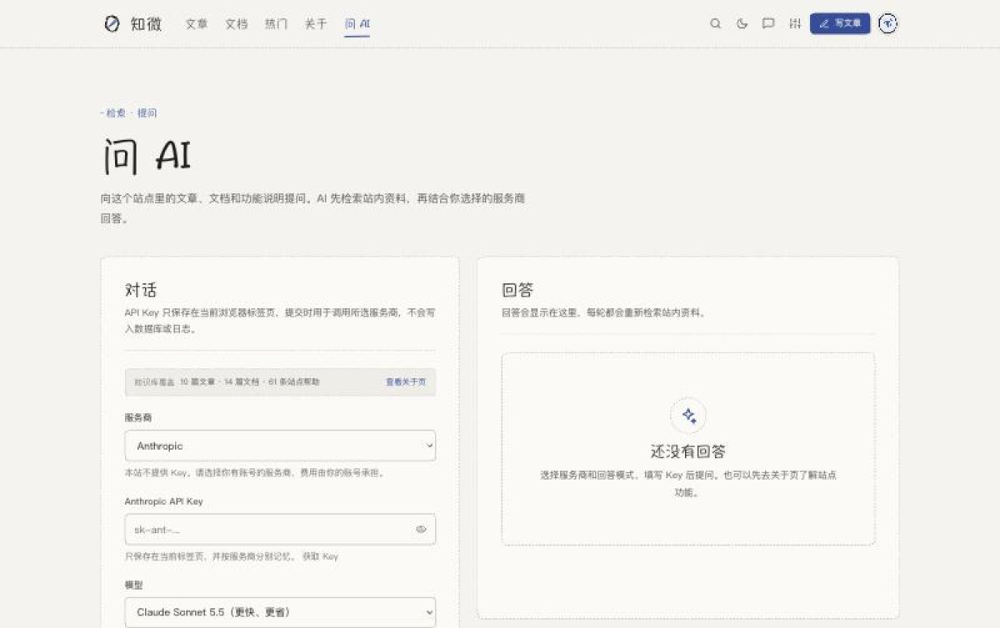
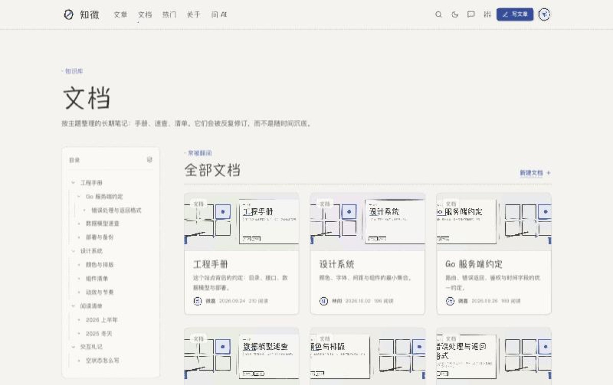
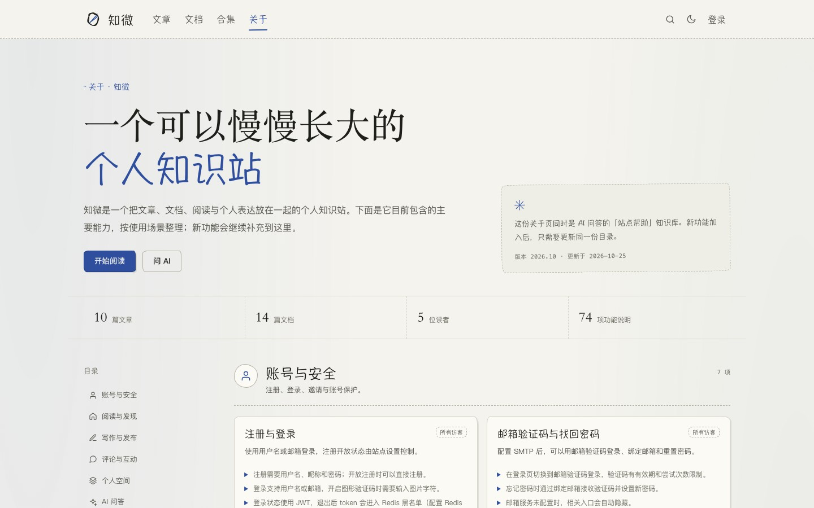

<p align="center">
  
</p>

<h1 align="center">Folio</h1>

<p align="center">
  <a href="https://github.com/qweijiaq/folio/actions/workflows/ci.yml"></a>
  <a href="https://go.dev/"></a>
  <a href="https://vuejs.org/"></a>
  <a href="https://www.docker.com/"></a>
  <a href="LICENSE"></a>
</p>

<p align="center">
  <strong>English</strong> · <a href="README.zh-CN.md">简体中文</a> · <a href="DEPLOY.md">Deploy guide</a>
</p>

**Folio is a self-hosted personal knowledge site built with Go and Vue 3.** Blog posts, a documentation tree, comments, RSS/SEO and bring-your-own-key AI question answering live in one deployable stack, on SQLite or MySQL, with or without Docker.

It is meant for two kinds of reader: someone who wants a runnable full-stack sample of a personal knowledge site, and someone who wants to see how Go + Vue can hold content, interaction, AI retrieval, object storage and an admin console in one system.

The full document — every environment variable, the data model, deployment on a real domain, object storage, QQ login, mail codes — is written in Chinese: [README.zh-CN.md](README.zh-CN.md). This page is the short version.

> The public demo is pending ICP registration, so there is no hosted instance yet. The screenshots below are from the current build, and the Mock mode lets you click through it locally in about thirty seconds.

## Thirty seconds, no database, no Docker

```bash
git clone https://github.com/qweijiaq/folio.git
cd folio
./scripts/dev-mock.sh
```

Open <http://localhost:5173> and sign in with the demo account `weijia / folio1234`. Mock mode seeds demo data on every start and clears it on stop.

## Screenshots

| Home | Article list |
| --- | --- |
|  |  |

| Editor | AI Q&A |
| --- | --- |
|  |  |

| Documentation tree | About |
| --- | --- |
|  |  |

## What it does

- **One admin for posts and docs**: articles and documentation share users, comments, favourites, search, notifications and the admin console.
- **Generative visuals**: rough.js draws covers and avatars from the title, summary, tags and category — no image assets to upload.
- **Real interaction**: two-level comments, comment likes, content likes, collections, follows, direct messages, notifications, @mentions.
- **Knowledge-base features**: documentation tree, private subtrees with read requests, wiki links and backlinks, version diffs, scheduled publishing.
- **AI Q&A with your own key**: chunked retrieval over your own content, strict or general mode, follow-up turns, streaming answers, cited sources.
- **SEO and syndication**: RSS 2.0, sitemap.xml, robots.txt, server-injected OG and JSON-LD share metadata.
- **Dark and light themes**, native CSS, responsive down to a phone.

## Three ways to run it

| Mode | Database | Redis | When | Command |
| --- | --- | --- | --- | --- |
| Mock | in-process memory | not needed | try it with nothing installed | `./scripts/dev-mock.sh` |
| SQLite | file | optional | daily development, single machine | `./dev.sh` |
| MySQL + Redis | Docker containers | Docker container | close to production | `docker compose up -d --build` |

Docker, in full:

```bash
cp .env.example .env
# set FOLIO_SECRET to at least 32 characters; on a first deploy also set
# FOLIO_ADMIN_USERNAME / FOLIO_ADMIN_PASSWORD
docker compose up -d --build
```

The site is then at <http://localhost:8080>; MySQL and Redis stay bound to localhost. Compose refuses to start without `FOLIO_SECRET` — there is no weak default key. Running from a bare server (DNS, security groups, Caddy, SMTP, object storage, monitoring, backups) is covered in [DEPLOY.md](DEPLOY.md).

## Stack

| Layer | Choice |
| --- | --- |
| Backend | Go 1.26 · Gin · GORM |
| Database | SQLite (default) / MySQL 8.4 |
| Cache | Redis 7 (optional) |
| Image storage | local disk (default) / Qiniu object storage (optional) |
| Auth | password, email code, optional QQ login; optional captcha; JWT (30 days) + optional Redis deny-list |
| Frontend | Vue 3 · Vite · Vue Router |
| Hand-drawn visuals | rough.js (canvas covers and avatars, SVG rules) |
| Rendering | markdown-it + highlight.js |
| Realtime | WebSocket (gorilla/websocket) with 10-second polling as a fallback |
| SEO | RSS 2.0, sitemap.xml, robots.txt, OG / JSON-LD |
| Styling | plain CSS, light and dark themes, responsive |

## Layout

```
server/        Go: Gin handlers, GORM models, auth, AI retrieval, object storage
web/           Vue 3 + Vite app; built assets are served by the Go binary
docs/          design notes and documentation
scripts/       dev-mock.sh, dev-mysql.sh, build helpers
DEPLOY.md      deployment on a real server, step by step
```

## License

MIT. See [LICENSE](LICENSE).
